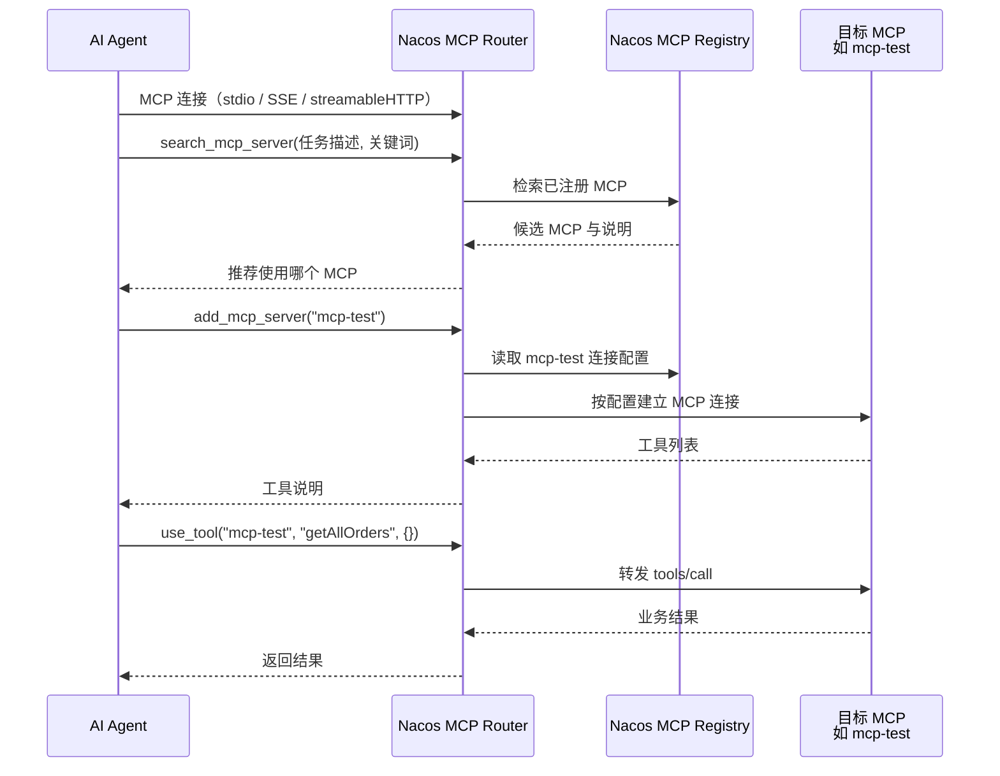

# Nacos MCP Router 原理与 Agent 使用指南

本文说明 [Nacos MCP Router](https://nacos.io/docs/next/manual/user/ai/nacos-mcp-router/) 在本项目（`mcp-test` + Higress + Nacos Registry）中的工作原理，以及 AI Agent 如何接入与调用。

官方文档：[Nacos MCP Router（英文）](https://nacos.io/en/docs/next/manual/user/ai/nacos-mcp-router/)

---

## 1. Router 是什么？

Nacos MCP Router 是一个 **标准 MCP Server**，可以理解为 **「MCP 的 MCP」**：

- 本身 **不实现** 业务工具（如 `getAllOrders`）。
- 向 Agent 提供 **在 Nacos MCP Registry 里发现、加载、代调** 其它 MCP Server 的能力。

在本仓库中，业务 MCP 为 Spring Boot 自动注册的 **`mcp-test`**（16 个 `@Tool`）。Router 通过 Nacos 读取 `mcp-test` 的连接与元数据，再在运行时建立到真实 MCP 的第二条连接并转发调用。

---

## 2. 与本项目两种 Agent 接入方式对比

| 方式 | Agent 连接地址 | 首次可见工具 | 适用场景 |
|------|----------------|--------------|----------|
| **直连 Higress SSE** | `http://localhost:8081/mcp/mcp-test/sse` | 直接看到 `mcp-test` 的 16 个工具 | 固定一个 MCP，配置简单 |
| **经 Nacos MCP Router** | `http://localhost:8000/mcp`（或 stdio Docker） | 先看到 Router 的 3 个「元工具」 | Registry 中有 **多个 MCP**，或希望按任务 **搜索** 再挂载 |
| **Router Proxy 模式** | `http://localhost:8002/mcp` | 与直连类似，工具列表来自 `mcp-test` | 只需把 SSE/stdio MCP **转成 streamableHTTP**，不需要搜索能力 |

```
  Cursor / Agent
       │
       ├─ 直连 Higress SSE ──► http://localhost:8081/mcp/mcp-test/sse  （固定 mcp-test）
       │
       ├─ Nacos MCP Router（Router 模式）──► http://localhost:8000/mcp
       │         search → add → use_tool
       │
       └─ Nacos MCP Router（Proxy 模式）──► http://localhost:8002/mcp  （透明转发 mcp-test）
```

---

## 3. 两种工作模式

### 3.1 Router 模式（默认 `MODE=router`）

对外暴露 **三个元工具**，由 LLM/Agent 编排完整链路：

| 工具 | 输入要点 | 作用 |
|------|----------|------|
| `search_mcp_server` | `task_description`（任务描述）、`key_words`（关键词） | 在 Nacos Registry（及可选 Compass 等）中 **检索** 与任务相关的 MCP Server |
| `add_mcp_server` | `mcp_server_name`（如 `mcp-test`） | **加载** MCP：从 Nacos 读配置；stdio 类会安装/拉起，SSE 等会 **建立 MCP 连接** |
| `use_tool` | `mcp_server_name`、`mcp_tool_name`、`params` | **代理调用** 已加载 MCP 上的某个工具，返回目标 MCP 的执行结果 |

**注意**：Agent 刚连接 Router 时 **不会** 直接列出 `getAllOrders` 等 16 个业务工具；需先 `add_mcp_server("mcp-test")`，之后业务调用仍通过 **`use_tool`** 间接完成（除非客户端自行展平子 MCP 工具，一般不建议依赖）。

### 3.2 Proxy 模式（`MODE=proxy` + `PROXIED_MCP_NAME`）

- 不再提供上述三个元工具。
- **透明转发**：把 Nacos 中指定 MCP（本仓库默认 `mcp-test`）转为 **streamableHTTP**。
- Agent 使用方式与普通 MCP 相同：`tools/list`、`tools/call` 直接针对 `mcp-test` 的工具。

本仓库启用方式：

```bash
ENABLE_MCP_ROUTER_PROXY=true ./scripts/setup-nacos-mcp-router.sh
# 或
docker compose -f docker-compose-infra.yml --profile mcp-proxy up -d
```

端点：`http://localhost:8002/mcp`。

---

## 4. 工作原理（调用链）



**实现要点**（便于排障）：

1. Router 使用 `NACOS_ADDR`、`NACOS_USERNAME`、`NACOS_PASSWORD`、`NACOS_NAMESPACE` 访问 Registry。
2. `add_mcp_server` 根据 Nacos 中该 MCP 的协议类型（stdio / SSE / streamableHTTP 等）建立 **第二条 MCP 客户端连接**（具体目标以 Nacos 中 `mcp-test` 的配置为准，可能经 Higress 或应用实例）。
3. `use_tool` 仅 **转发** 请求，业务逻辑仍在 `nacos-mcp-demo` 的 `@Tool` 中执行。
4. Compose 中 Router 容器在 `mcp-net` 内访问 `nacos-standalone:8848`；宿主机上的 Cursor 使用 `localhost:8000` 即可。

---

## 5. Agent 如何使用（Router 模式）

### 5.1 前置条件

1. 基础设施与应用已启动：`mcp-net`、Nacos、`nacos-mcp-demo`（`mcp-test` 已写入 Nacos）。
2. Router 已启动：`./scripts/setup-nacos-mcp-router.sh`。

### 5.2 客户端配置（Cursor / Cherry Studio）

streamableHTTP（推荐，与本仓库 Compose 一致）：

```json
{
  "mcpServers": {
    "nacos-mcp-router": {
      "url": "http://localhost:8000/mcp"
    }
  }
}
```

更多示例（SSE、Docker stdio + `mcp-net`）：见 [`scripts/mcp-client-nacos-router.json`](./scripts/mcp-client-nacos-router.json)。

### 5.3 示例：用户问「目前有哪些订单？」

| 步骤 | Agent 调用的 Router 工具 | 参数示例 |
|------|--------------------------|----------|
| 1 | `search_mcp_server` | `task_description`: 「查询系统中的所有订单」；`key_words`: 「订单, order, mcp-test」 |
| 2 | `add_mcp_server` | `mcp_server_name`: `"mcp-test"` |
| 3 | `use_tool` | `mcp_server_name`: `"mcp-test"`；`mcp_tool_name`: `"getAllOrders"`；`params`: `{}` |

Agent 将第 3 步返回的 JSON 整理成自然语言回复用户。

### 5.4 示例：组合调用「张三买了什么？」

与直连 `mcp-test` 时的业务逻辑相同，但入口均为 `use_tool`：

1. `use_tool("mcp-test", "getUserByName", {"name": "张三"})` → 得到 `user-1`
2. `use_tool("mcp-test", "getOrdersByUserId", {"userId": "user-1"})` → 订单列表

若尚未 `add_mcp_server("mcp-test")`，Agent 应先执行步骤 2（加载 MCP）。

### 5.5 与直连 Higress 的行为差异

| 维度 | 直连 `8081/mcp/mcp-test/sse` | 经 Router（Router 模式） |
|------|------------------------------|---------------------------|
| 工具发现 | 一次 `tools/list` 得到 16 个工具 | 先 3 个元工具，再 `add` 后通过 `use_tool` 调用业务工具 |
| MCP 选择 | 固定 `mcp-test` | 可 `search_mcp_server` 在 Registry 中选型 |
| 客户端配置 | 一个 Higress URL | 一个 Router URL（`8000`） |

业务工具参数说明见 [MCP-USAGE-EXAMPLES.md](./MCP-USAGE-EXAMPLES.md)。

---

## 6. 部署与环境变量

### 6.1 一键启动

```bash
./scripts/setup-nacos-mcp-router.sh
ENABLE_MCP_ROUTER_PROXY=true ./scripts/setup-nacos-mcp-router.sh   # 可选 Proxy
```

### 6.2 容器与端口

| 容器 | 宿主机端口 | 说明 |
|------|------------|------|
| `nacos-mcp-router` | 8000 | Router 模式，`/mcp`、`/sse` |
| `nacos-mcp-router-proxy` | 8002 | Proxy 模式，需 profile `mcp-proxy` |

定义见 [`docker-compose-infra.yml`](./docker-compose-infra.yml)。

### 6.3 主要环境变量

| 变量 | 说明 | 本仓库默认 |
|------|------|------------|
| `NACOS_ADDR` | Nacos 地址（含端口） | 容器内 `nacos-standalone:8848` |
| `NACOS_USERNAME` / `NACOS_PASSWORD` | 访问 Nacos（**密码必填**） | `nacos` / `nacos` |
| `NACOS_NAMESPACE` | 命名空间 | `public` |
| `TRANSPORT_TYPE` | `stdio` / `sse` / `streamable_http` | `streamable_http` |
| `MODE` | `router` / `proxy` | `router`（Proxy 容器为 `proxy`） |
| `PROXIED_MCP_NAME` | Proxy 模式下被转换的 MCP 名 | `mcp-test` |
| `PORT` | SSE / streamableHTTP 监听端口 | `8000` |

---

## 7. 常见问题

### Router 连上后看不到 getAllOrders？

Router 模式下这是预期行为。请先 `add_mcp_server("mcp-test")`，再通过 `use_tool` 调用；或改用 Proxy 模式 / 直连 Higress SSE。

### search 不到 mcp-test？

确认 `nacos-mcp-demo` 已启动且 Nacos 控制台 **AI 管理 → MCP Server** 中存在 `mcp-test`：

```bash
curl "http://localhost:8848/nacos/v1/ns/instance/list?serviceName=nacos-mcp-demo"
./scripts/setup-nacos-mcp-router.sh
```

### stdio 方式 Docker 连不上 Nacos？

Cursor 启动的 Router 容器需加入 **`mcp-net`**，且 `NACOS_ADDR=nacos-standalone:8848`。示例见 `scripts/mcp-client-nacos-router.json` 中的 `stdio_docker_mcp_net`。

---

## 8. 相关文件

| 文件 | 说明 |
|------|------|
| [`scripts/setup-nacos-mcp-router.sh`](./scripts/setup-nacos-mcp-router.sh) | 启动与校验 |
| [`scripts/mcp-client-nacos-router.json`](./scripts/mcp-client-nacos-router.json) | MCP 客户端配置示例 |
| [`README.md`](./README.md) | 整体架构与快速开始 |
| [`HIGRESS_DEPLOYMENT_GUIDE.md`](./HIGRESS_DEPLOYMENT_GUIDE.md) | 端口与 Higress 排障 |
